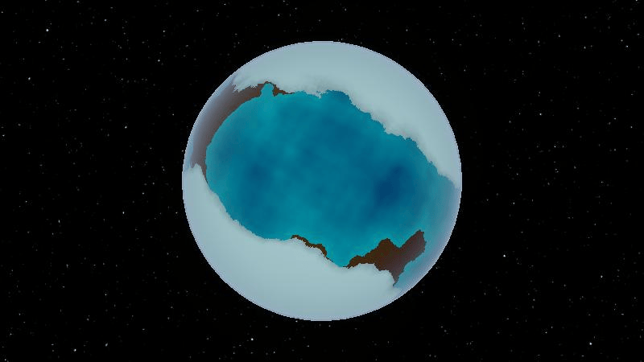

# Planetary Equilibrium Simulation

A modular simulation framework developed for a planetary ecosystem game in Unity.



The project models a set of interconnected environmental systems (temperature, water cycle, atmosphere, flora, tectonics, etc.) as a dynamic system where each module contributes to the evolution of the global state over time.

Although originally designed for a planetary simulation, the core architecture is intentionally separated from game-specific logic and built around reusable simulation concepts such as state variables, modules, derivatives, and numerical integration.

---

## Overview

The simulation is based on a simple principle:

1. Each module observes the current state.
2. Each module computes its contribution to state change.
3. All contributions are aggregated.
4. An integrator advances the simulation.
5. The resulting state becomes the input for the next step.

```text
Current State
      │
      ▼
Simulation Modules
      │
      ▼
Aggregated Derivatives
      │
      ▼
Integrator
      │
      ▼
Next State
```

This approach makes individual systems independent and easy to extend while keeping the simulation deterministic and predictable.

---

## Architecture

### SystemState

`SystemState` represents the complete simulation state at a given moment.

All simulation variables are stored in a contiguous array and accessed through indices resolved by the module registry.

#### Examples of state variables

* Temperature
* Water
* Ice
* Atmospheric Oxygen
* Greenhouse Gases
* Flora
* Tectonic Activity

The simulation core treats these variables generically and does not contain domain-specific logic.

---

### Simulation Modules

Each simulation module is responsible for a single domain concept.

#### Examples

* `TemperatureModule`
* `WaterModule`
* `IceModule`
* `FloraModule`

Modules never directly modify the simulation state.

Instead, they calculate derivatives describing how the state should change.

#### Example

```csharp
TemperatureDerivative =
    SolarHeating
    + GreenhouseHeating
    - WaterCooling
    - IceCooling
    - RadiativeCooling;
```

This keeps simulation logic isolated, testable, and easy to reason about.

---

### ModuleOutput

Modules return their results as `ModuleOutput`.

A module output contains:

* State derivatives
* Optional integration coefficients
* Diagnostic information

The simulation core aggregates outputs from all modules before integration.

---

### Integrators

State advancement is delegated to an `IIntegrator`.

This allows different numerical integration methods to be swapped without changing simulation logic.

#### Current implementation

* `SemiImplicitIntegrator`

#### Possible future extensions

* Explicit Euler
* Runge-Kutta
* Verlet Integration

---

### SimulationCore

`SimulationCore` is the central orchestrator responsible for:

* Collecting module outputs
* Aggregating derivatives
* Executing integration
* Applying state constraints
* Updating simulation time
* Publishing simulation events

The core contains no knowledge about specific planetary systems.

Its responsibility is limited to simulation execution.

---

## Design Goals

### Modularity

Each system is implemented as an isolated module.

Adding a new environmental process does not require modifying existing modules.

### Determinism

Given the same initial state and configuration, the simulation produces identical results.

This simplifies balancing, debugging, and automated testing.

### Separation of Concerns

Simulation logic is separated from:

* User input
* Presentation
* Visual effects
* Unity-specific gameplay systems

### Extensibility

The architecture was designed to support additional simulation domains by introducing new modules and state variables.

---

## Example: Water Cycle

The water system demonstrates interactions between multiple modules.

```text
Water ─────► Vapor
  ▲            │
  │            ▼
 Ice ◄──── Temperature
```

* Temperature affects evaporation and freezing.
* Water, ice, and vapor influence temperature in return.
* Each module computes only its own contribution, while the simulation core handles aggregation and integration.

---

## Testing Strategy

The simulation is designed to be testable independently from Unity gameplay code.

### Recommended test coverage

* Integrator correctness
* Module aggregation
* Deterministic simulation results
* Conservation rules (e.g. water mass)
* Domain-specific module behavior

### Example assertions

* Constant derivative produces expected state progression.
* Module outputs are aggregated correctly.
* Greenhouse gases increase temperature growth.
* Water cycle conserves total mass under controlled conditions.

---

## Technologies

* Unity
* C#
* ScriptableObject-based module configuration
* Custom simulation framework
* Numerical integration techniques

---

## Future Improvements

* Additional integration methods
* Parallel module execution
* Improved diagnostics and profiling
* Extended automated test suite
* Extraction of the simulation core into a standalone package

---

## Motivation

Most gameplay simulations are implemented directly inside update loops and become increasingly difficult to maintain as complexity grows.

This project explores a more structured approach inspired by dynamic systems modeling, where independent modules contribute to a shared state and numerical integration is used to advance the simulation over time.
